<p align="center">
  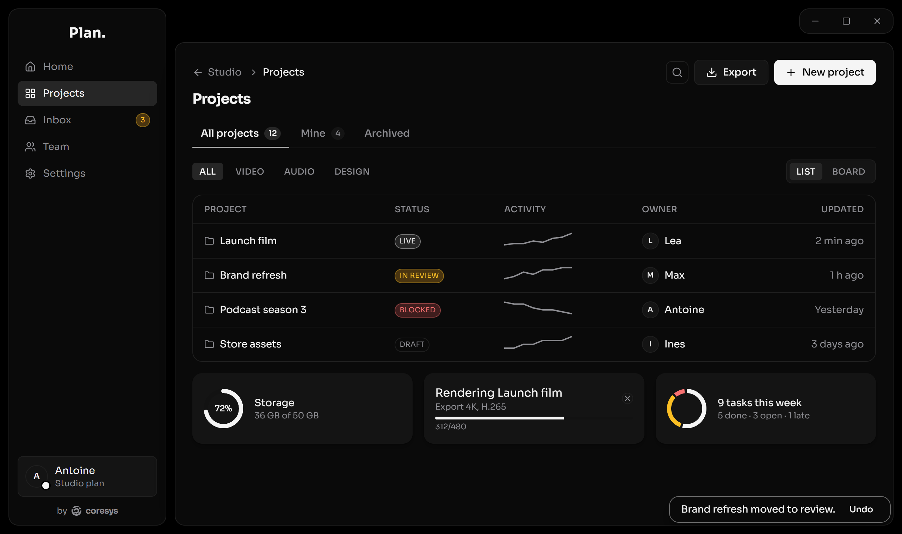
</p>

<h1 align="center">cscl-ui</h1>

<p align="center"><strong>The component library behind every CoreSys app.</strong><br/>
Dark-first, one accent colour, chrome that floats. React + Tailwind v4, ready for Tauri.</p>

---

SLDR, DRIFT, Planwise, Crayon and CORE all look and behave like one family. That's cscl-ui: about 100 components, the design tokens and the motion they share, in one versioned package. Bring your own accent colour and typeface; everything else is decided.

## Why cscl-ui

- **One look, any brand.** The palette is neutral out of the box. Set two variables, `--color-accent` and `--color-accent-muted`, and every selected row, focused field, switch and primary button follows.
- **Built for desktop tools.** Floating panels over a black canvas, custom window chrome for Tauri (native traffic lights on macOS included), no accidental text selection, thin scrollbars, a boot sequence that slides your identity into place.
- **Keyboard and screen reader first.** Focus traps in modals, a stack so Escape closes only the top overlay, roving focus in tabs and menus, `aria-*` states everywhere, never colour alone.
- **Honest motion.** One easing curve, five durations, and reduced-motion respected everywhere except the boot splash.
- **No i18n lock-in.** Components never translate. Content strings come from you; fixed interface strings (Close, Remove, Cancel…) have English defaults you override through a `labels` prop.
- **Light theme included.** One attribute on `<html>`.

## Showroom

### Primitives

Buttons that name the act, badges that carry meaning, chips, switches, sliders and banners.

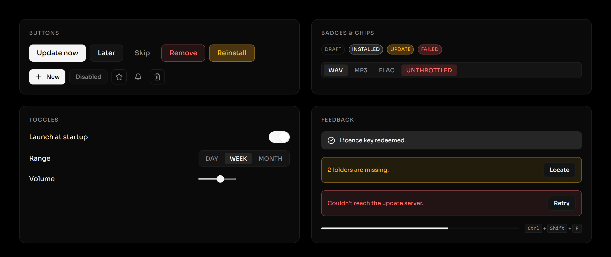

### Forms

Labelled fields with hints and errors, a select drawn by the app (never the OS menu), tags with comma entry, radios, checkboxes and a colour picker, all keyboard-operable.

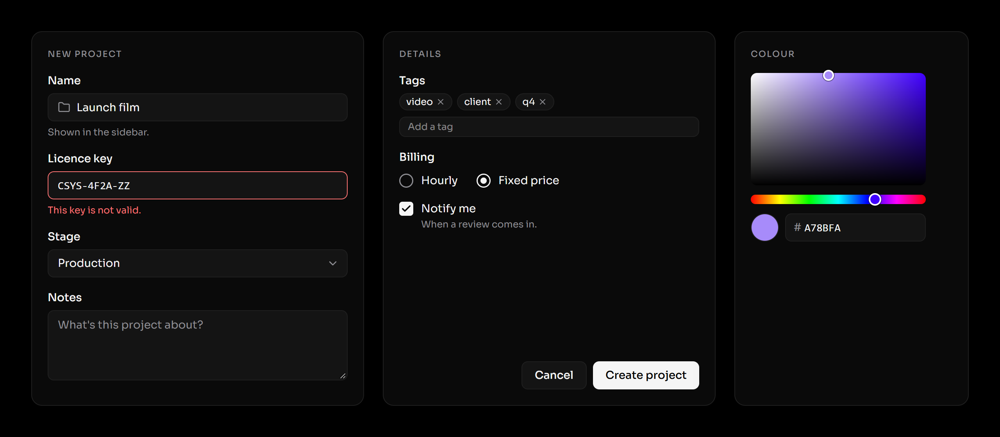

### Menus and popovers

One menu engine for right-click and "⋯" menus: icons, sections, checkboxes, submenus, disabled items. Popovers anchor to their trigger and flip when there's no room.

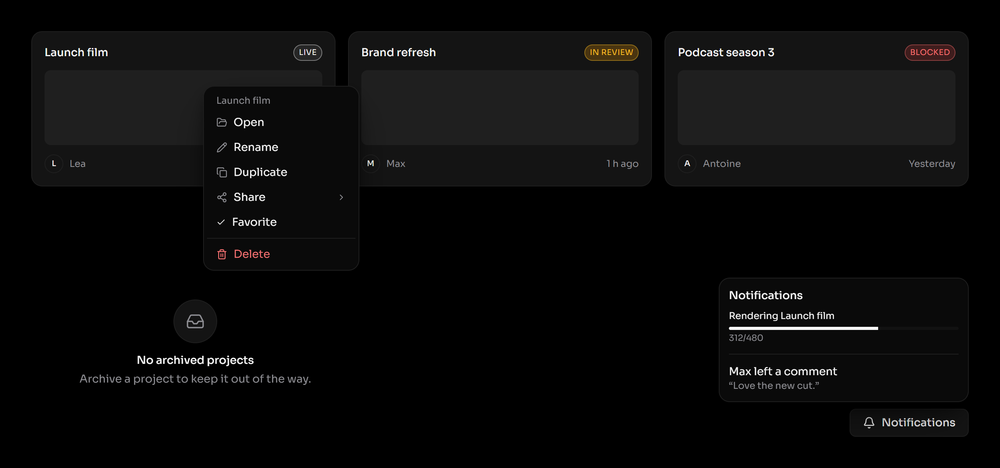

### Dialogs

Ask the whole question, name the act. Declarative `<ConfirmDialog>`, or `await dialogs.confirm()` from any handler.

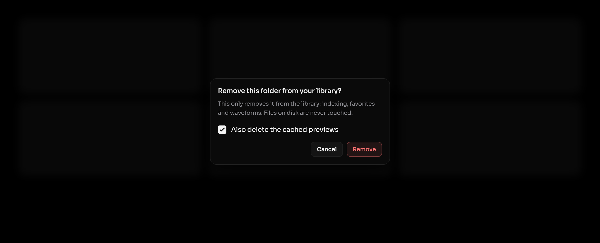

### Command palette

The ⌘K palette: grouped results with icons, thumbnails, hints and status badges, all from the keyboard.

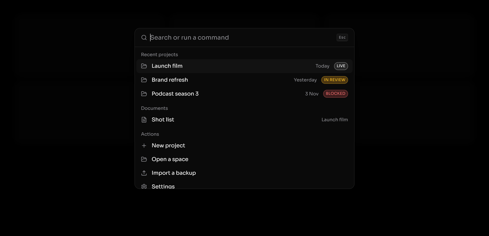

### Calendar

A week grid you draw on: drag empty time to create, drag an event to move it, drag its edge to resize. Overlaps share the column, a red line marks now. With a compact month and a week strip.

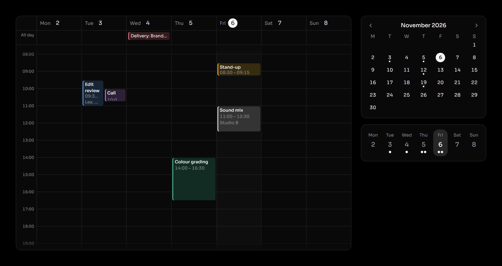

### Media

A player bar for audio, with a clickable waveform and an In/Out zone, and a review timeline for video with comment markers and ranges. `VideoStage` adds frame-accurate timecode, J/K/L and frame stepping.

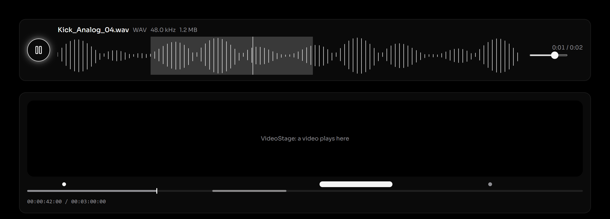

### Dashboard

A grid of widget cards, shown in edit mode: drag, resize, keyboard moves, a per-card error boundary. Here with a focus timer, a ring, a sparkline, a contribution heatmap and a Markdown note.

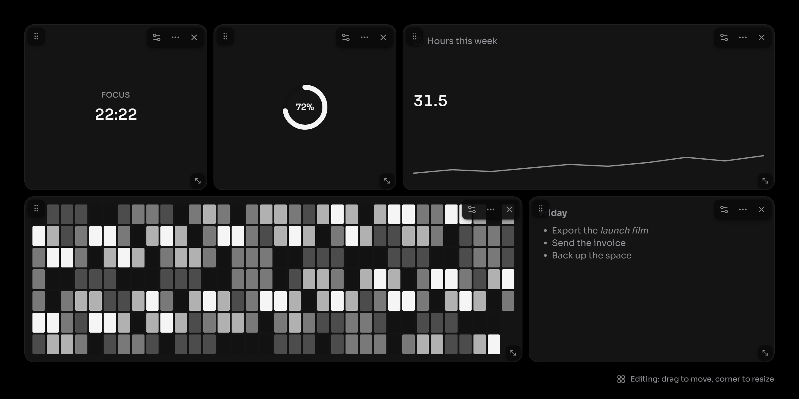

### Editor

A Notion-like document editor: "/" for blocks, Markdown shortcuts and paste, a format bubble, comments pinned to words, links to other documents and "@" mentions supplied by your app.

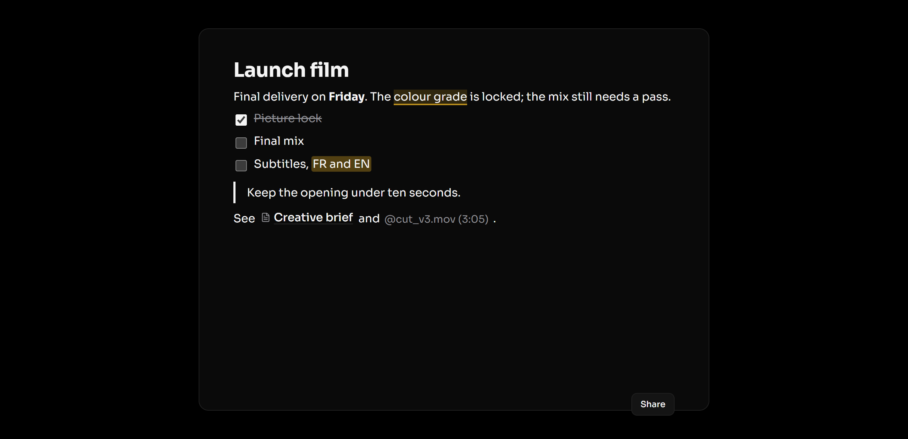

### Theming

The same components under the default neutral accent, three brand accents, and the light theme.

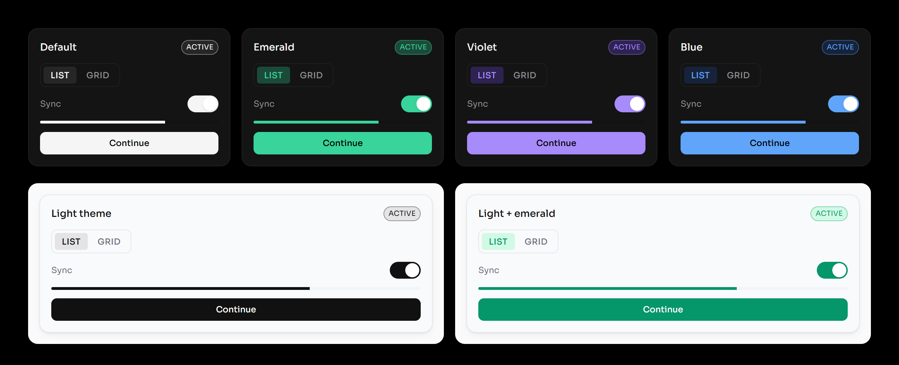

### What's inside

| Group | Components |
|---|---|
| Primitives | `Button` · `IconButton` · `Badge` · `Card` · `Chip` · `SegmentedControl` · `Switch` · `Slider` · `Kbd` · `ScrollArea` |
| Inputs | `TextField` · `TextArea` · `Select` · `Checkbox` · `RadioGroup` · `Label` · `TagInput` · `Combobox` · `HeroSearchInput` · `ShortcutRecorder` · `ColorPicker` · `ColorPickerButton` |
| Overlays | `Modal` · `ConfirmDialog` · `DialogsProvider` / `useDialogs` · `ConsentDialog` · `DetailsDialog` · `UpdateDialog` · `IconPicker` · `Menu` / `useContextMenu` / `DropdownMenu` · `Popover` · `Tooltip` · `CommandPalette` · `CommentCard` |
| Feedback | `ToastProvider` / `useToast` · `InlineBanner` · `EmptyState` · `ErrorState` · `FatalErrorScreen` · `Skeleton` · `ProgressBar` · `ProgressIndicator` · `JobRow` · `JobsPopover` · `LogConsole` · `FileDropOverlay` / `useWindowFileDrop` |
| Data display | `Table` · `TreeView` · `ListView` · `ListRow` · `InlineRenameInput` · `Avatar` · `Sparkline` · `MiniWaveform` · `Waveform` · `Ring` · `Donut` · `Heatmap` · `TimeReadout` · `ImageCaption` · `CreditsList` |
| Media | `MediaTransport` · `Timeline` · `VideoStage` |
| Calendar | `WeekGrid` · `MonthGrid` · `WeekStrip` |
| Dashboard | `WidgetGrid` · `WidgetFrame` · `WidgetBoundary` · `WidgetEmpty` · `WidgetDef` |
| Editor² | `RichTextEditor` · `FormatBubble` · comment, colour and highlight marks · `DocLink` · `Mention` |
| Markdown³ | `MarkdownText` |
| Navigation | `Tabs` · `Breadcrumbs` · `SidebarTabsDialog` · `TabBar`¹ |
| Web | `SiteHeader` · `Hero` · `ProductRow` · `FeatureGrid` · `SiteFooter` · `Pagination` · `Link` · `Accordion` |
| Branding | `CoresysMark` · `WordTicker` · `BootTransitionSplash` |
| Window (Tauri)¹ | `WindowControls` · `TitleBar` · `SyncLinkProvider` · `useTauriFileDrop` |
| Hooks & utilities | `cn` · `useTheme` · `useAsyncResource` · `useDebouncedValue` · `useListKeyboardNav` · `useResizableWidth` · `useInfiniteScrollSentinel` · `useTypewriterPlaceholder` · `useScrollFade` · `useWheelScrollX` · `useNow` · colour, calendar, timecode and grid helpers · `retrySchedule` · `planTreeMove` · `resolveLucideIcon` |

¹ From `@coresys/cscl-ui/tauri`. ² From `@coresys/cscl-ui/editor`. ³ From `@coresys/cscl-ui/markdown`.

---

## Getting started

### Requirements

React 18.3 or 19, Tailwind CSS v4, `lucide-react`, `class-variance-authority`, `clsx` and `tailwind-merge`. `@tauri-apps/api` v2 only if you use the `/tauri` entry, `marked` for `/markdown`, and for `/editor` the tiptap v3 packages plus `marked`:

```bash
pnpm add marked @tiptap/core @tiptap/react @tiptap/pm @tiptap/starter-kit @tiptap/extension-list @tiptap/extensions @tiptap/suggestion
```

### Install

The package is distributed from Git, by tag:

```bash
pnpm add github:coresys-dev/cscl-ui#v2.0.0
```

```bash
pnpm add lucide-react class-variance-authority clsx tailwind-merge
```

`prepare` builds `dist/` on install. To work on the library and an app side by side, link it instead: `pnpm link ../cscl-ui`.

### Wire up the styles

In your app's main CSS, after Tailwind:

```css
@import "tailwindcss";
@import "@coresys/cscl-ui/theme.css";

/* Let Tailwind see the classes the components use. */
@source "../node_modules/@coresys/cscl-ui/dist";
```

`theme.css` brings three layers you can also import one by one from `@coresys/cscl-ui/theme/`: `tokens.css` (colours, radii, shadows, fonts), `motion.css` (easing and keyframes) and `base.css` (desktop defaults: no drag-selection, thin scrollbars, focus ring, scroll fades). With the editor, add `@import "@coresys/cscl-ui/theme/editor.css";` for the document typography.

### Make it yours

Override the accent pair and the typeface after the import. Nothing else changes per app.

```css
@theme {
  --color-accent: #38d49b;
  --color-accent-muted: #1c4a3a;
  --font-sans: "Sora", ui-sans-serif, system-ui, sans-serif;
}

:root[data-theme="light"] {
  --color-accent: #059669;
  --color-accent-muted: #d1fae5;
}
```

Self-host the font (for example `@fontsource/sora`): no CDN, no network call at runtime. With a face other than Sora, set `--optical-offset` (see `theme/base.css`).

Light theme: set `data-theme="light"` on `<html>`, or let `useTheme()` do it from a persisted setting.

### Use it

```tsx
import { Button, DialogsProvider, ToastProvider, useDialogs, useToast } from "@coresys/cscl-ui";
import { Trash2 } from "lucide-react";

function RemoveFolder({ onRemove }: { onRemove: () => Promise<void> }) {
  const dialogs = useDialogs();
  const toast = useToast();
  return (
    <Button
      variant="destructive"
      onClick={async () => {
        const ok = await dialogs.confirm({
          title: "Remove this folder from your library?",
          body: "Files on disk are never touched.",
          confirmLabel: "Remove",
        });
        if (!ok) return;
        await onRemove();
        toast.showSuccess("Folder removed.", { label: "Undo", run: () => {} });
      }}
    >
      <Trash2 /> Remove
    </Button>
  );
}

export function App() {
  return (
    <ToastProvider>
      <DialogsProvider>
        <RemoveFolder onRemove={async () => {}} />
      </DialogsProvider>
    </ToastProvider>
  );
}
```

A right-click menu:

```tsx
import { useContextMenu, type MenuEntry } from "@coresys/cscl-ui";
import { Pencil, Trash2 } from "lucide-react";

function Row({ name }: { name: string }) {
  const menu = useContextMenu();
  const items: MenuEntry[] = [
    { type: "item", key: "rename", label: "Rename", icon: Pencil, onSelect: () => {} },
    { type: "separator", key: "s" },
    { type: "item", key: "delete", label: "Delete", icon: Trash2, danger: true, onSelect: () => {} },
  ];
  return (
    <div onContextMenu={(e) => menu.open(e, items)}>
      {name}
      {menu.element}
    </div>
  );
}
```

### Tauri window chrome

```tsx
import { TitleBar, WindowControls } from "@coresys/cscl-ui/tauri";
```

Windows/Linux need `"decorations": false`; macOS keeps native decorations with `"titleBarStyle": "Overlay"` and moves the traffic lights into the island. That needs one Rust command in your app: copy it from [`src/window/README.md`](src/window/README.md).

## Conventions

- **Colour is a token, always.** Components use `bg-surface`, `text-text-muted`, `border-border`… never a literal colour. `accent` marks state (selected, active, focused) and the one primary action, never decoration. `accent-2` means attention, `danger` means destructive.
- **Surfaces layer, they don't shadow.** `bg` canvas → `surface` panel → `surface-raised` field → `surface-hover`. `shadow-float` is for floating panels, `shadow-card` for flush cards.
- **Copy.** Sentence case, address the user as *you*, no exclamation marks, no emoji. Buttons name the act ("Remove", "Update now"), never "OK". Small labels are uppercase.
- **Strings.** Content (titles, bodies, action names, counts) is a required prop. Fixed interface strings take a `labels` prop with English defaults. Pluralise and format before passing.
- **Icons.** `lucide-react` only. 14px in dense rows, 16px in buttons, 24px in empty states.
- **Motion.** `--ease-in-out-quart` and the `animate-*` utilities from `motion.css`. Don't add a one-off curve.

The full rules, with every token and component card, live in the CoreSys design system.

## Development

```bash
pnpm install
```

```bash
pnpm check
```

```bash
pnpm showroom
```

| Script | What it does |
|---|---|
| `pnpm build` | Compiles `src/` to `dist/` (ESM + type declarations). |
| `pnpm typecheck` | Type-checks the whole library. |
| `pnpm test` | Runs the Node test suites (`src/**/*.test.*`). |
| `pnpm format` | Formats `src/` and `theme/` with Prettier. |
| `pnpm showroom` | Starts the showroom on port 5198, rendering `src/` directly. |

The showroom is in `showroom/` (run `pnpm install` there once). With it running, `node showroom/capture.mjs` refreshes the screenshots in `docs/showroom/` using headless Edge (pass another Chromium path as argument elsewhere).

### Layout

```
theme/       tokens.css · motion.css · base.css · index.css
src/
  primitives/  inputs/  overlays/  feedback/  data-display/
  navigation/  web/  media/  calendar/  dashboard/  branding/
  window/  providers/  editor/  markdown/  lib/
  index.ts     the main entry
  tauri.ts     the Tauri-only entry
  editor.ts    the editor entry (tiptap)
  markdown.ts  the Markdown entry (marked)
showroom/    Vite app rendering every scene, plus capture.mjs
```

## Migrating from v1

v1 was copied into each app by hand; v2 is a package. Remove the copied files, install, and update imports to `@coresys/cscl-ui`.

| v1 | v2 |
|---|---|
| `theme/tokens.css` imported Tailwind itself | Import `tailwindcss` first, then `@coresys/cscl-ui/theme.css`, and add the `@source` line |
| Default accent was SLDR's green | Neutral (`#f5f5f5` / `#262626`); set your own pair |
| `ContextMenu` + `DropdownMenu` (two components) | One `Menu` engine: `useContextMenu()`, `DropdownMenu` (items are `MenuEntry`, with icons, labels, submenus) |
| `ConfirmDialog` with its own overlay | `ConfirmDialog` on `Modal` (focus trap, overlay stack), plus `useDialogs()`; `content` slot unchanged |
| `PrivacyConsentDialog` (apps) | `ConsentDialog` |
| `Sparkline` (audio peaks) | `MiniWaveform`; `Sparkline` is now a data trend line taking `values` |
| `useNativeTrafficLights(ref)` | Gone: `WindowControls` reports its own rect; the Rust command takes one `rect` argument |
| Window, `TabBar`, `SyncLinkProvider` in the main entry | `@coresys/cscl-ui/tauri` |
| `labels` required on `TagInput`, `IconPicker`, `DetailsDialog`, `TabBar`, `LogConsole` | Optional, English defaults |
| App-level `Field`, `Tabs`, `Tooltip`, `Popover`, `Avatar`, `Toast`… | In the library, merged from DRIFT, Crayon, CORE and Planwise |
| Web components drawn only in the design system | In the library under `web/` (`SiteHeader`, `Hero`, `Pagination`…) |
| `Waveform` took an `audioRef` | It takes `getFraction: () => number` (any player) and an optional In/Out `range` |
| App-level palettes, calendars, players, dashboards, editors | `CommandPalette`, `WeekGrid` / `MonthGrid` / `WeekStrip`, `MediaTransport` / `VideoStage`, `WidgetGrid`, `RichTextEditor` (from DRIFT, SLDR, Planwise and Crayon) |
